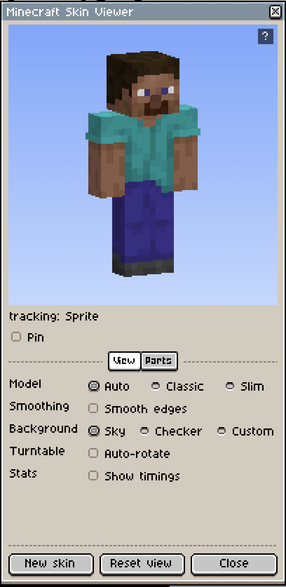
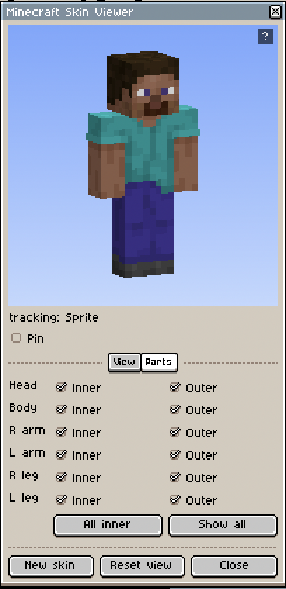

# MC-ASEPRITE-TOOLS

Minecraft texture tools for [Aseprite](https://www.aseprite.org/).

Includes a 3D skin viewer that updates during painting. A block and item viewer for
resource pack textures is planned.

**Notice:** This software is not an official Minecraft product. It is not approved by or
associated with Mojang or Microsoft.

## Skin viewer

  
  

To view a skin, open a 64x64 sprite and choose **View > MC Aseprite Tools > View Skin**.

To create a skin, choose **View > MC Aseprite Tools > New Skin...** and select the
default Steve or Alex skin, a UV guide, or a blank canvas.

- Classic (4px) and slim (3px) arm models.
- Tracks the skin in the active tab. **Pin** locks the viewer to one skin.
- Per-part visibility, including separate inner and outer layers.
- Edge smoothing, turntable, and sky, checkerboard or custom color backgrounds.

### Controls

The 3D view must have keyboard focus; click it once. The **?** in its top-right corner
displays this list.

| Input | Action |
|---|---|
| Drag | Orbit |
| Shift-drag or middle-drag | Pan |
| Wheel, `+`, `-` | Zoom |
| Arrow keys | Orbit in steps |
| `1` to `5` | Front, right, back, left, three-quarter view |
| `R` | Reset the view |
| `B` | Next background |
| `T` | Toggle turntable |
| `I`, `O` | Toggle inner or outer layer |
| `Shift`+`1` to `6` | Toggle head, body, right arm, left arm, right leg, left leg |
| `H` or `?` | Toggle the key list |

## Installation

Requires Aseprite 1.3 or newer. Tested on 1.3.18.

1. Download `MC-ASEPRITE-TOOLS.aseprite-extension` from the releases page.
2. Double-click the file, or add it in Aseprite under **Edit > Preferences > Extensions >
   Add Extension**.
3. Restart Aseprite.

## Source layout

| Path | Description |
|---|---|
| `main.lua` | Registers the menu commands and loads the modules |
| `src/viewer.lua` | Viewer window: input, settings, sprite tracking |
| `src/raster.lua` | Software renderer |
| `src/model.lua` | Player geometry and skin UV layout |
| `src/templates.lua` | New Skin dialog and generated starting skins |
| `src/skinfetch.lua` | Download and cache of the default skins |

Project scope is described in [SCOPE.md](SCOPE.md).

## License

[MIT](LICENSE).
